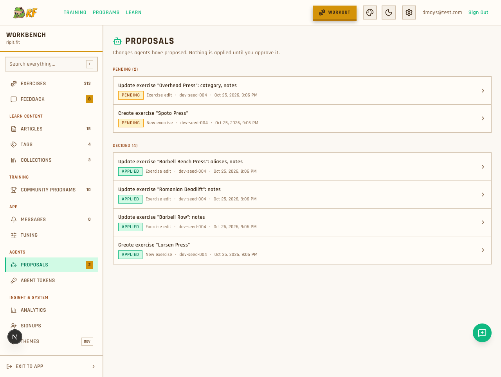
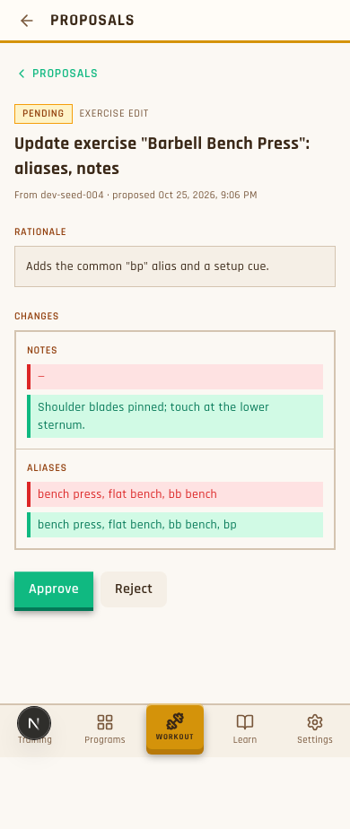
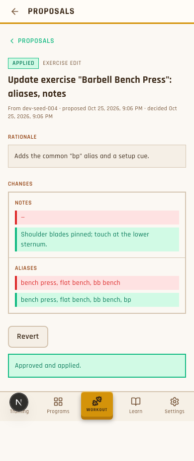
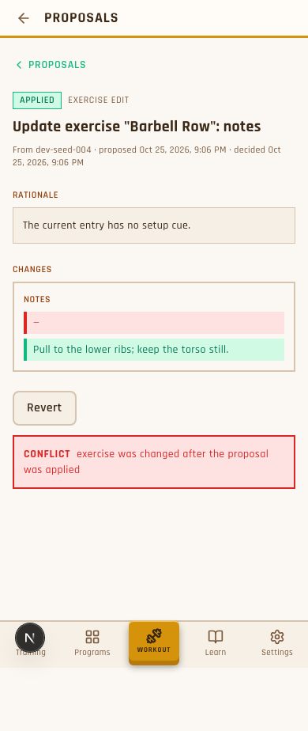
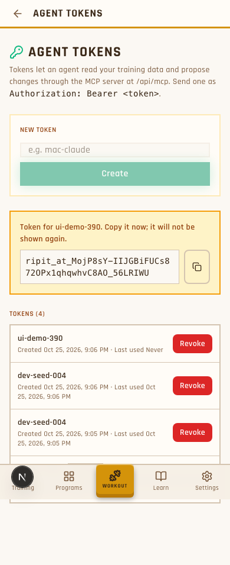

# Review: items 003, 004, 005

**Your call:** accept each item, or note what to change. 006 (sending proposals to Discord) is paused until you're done.

The lead re-ran each item's checks. Nothing is committed; everything is on branch `feature/agent-tools` in worktree1.

---

## 004: admin pages for proposals and agent tokens

**What you get:**
- An **Agents** group in the Workbench sidebar, with **Proposals** (badge shows the pending count) and **Agent Tokens**.
- A proposals list: pending first, then decided.
- A detail page showing the agent's rationale, which token proposed it, and a before/after field diff.
  - Pending proposals have **Approve** and **Reject**.
  - Applied proposals have **Revert**.
- Tokens page: create a token (the secret is shown once, with a copy button), see when each was last used, revoke.
- **Undo is now safe.** If you edited the exercise after approving, Revert refuses with "conflict" instead of overwriting your edit.

**Checks (lead re-ran):**
- Proposal tests: 104/104 pass.
- Type-check is clean, apart from an expected error from 005's test, whose notifier code doesn't exist until 006.
- Agent text is shown as plain text only. A test rationale containing `<script>` displayed as harmless text.

**Not checked:** dark theme, the copy button being clicked, and viewing as an editor instead of an admin.

**Look at these:**

List (desktop):

Pending update with diff (phone):

After approve (phone):

Revert refused because of a later edit (phone):

Token just created (phone):

**Accept 004?** ____

---

## 003: stricter proposal tests + the "undo conflict" test

**What changed:** the tests written in 001 now check exact answers instead of accepting anything error-shaped:
- The notification must carry a link ending in `/admin/proposals/<id>`.
- Refusals must say *why* with a specific code: `not_pending` when approving twice, `in_use` when reverting an exercise that's in a workout, `conflict` when it went stale.
- Tool errors must name the bad field (`primaryFAUs`) or the existing duplicate's id.
- New scenario: **revert is refused if the exercise was edited after approval.** It failed before 004 and passes now.

**Checks (lead re-ran):** before 004, only the new scenario failed. After 004, all 104 pass.

**Accept 003?** ____

---

## 005: tests for Discord notifications

**What it tests:** the 5 scenarios in `proposal-notifications.feature`:
1. A new proposal posts once to #proposals, with the title, summary and a link to its review page.
2. Agent text containing `@everyone` cannot ping anyone. Mentions are switched off on the message.
3. A very long summary is cut to fit Discord's limits, and invisible control characters are stripped.
4. No webhook configured → nothing is sent.
5. Discord down (or rate-limited) → the failure is logged and nothing crashes.

**Checks (lead re-ran):** all 5 fail only because the notifier doesn't exist yet. That's the correct state before 006.

**Lead's decision:** the proposal title becomes the Discord message title and the summary becomes its body. A network error must also not crash. That case isn't tested, so it's an explicit requirement in 006.

**Accept 005?** ____

---

## Next step

Fill in the blanks above, or reply in the terminal. Once you're done, I'll resume 006. Its last check needs you: a real message should appear in #proposals with a working link.
