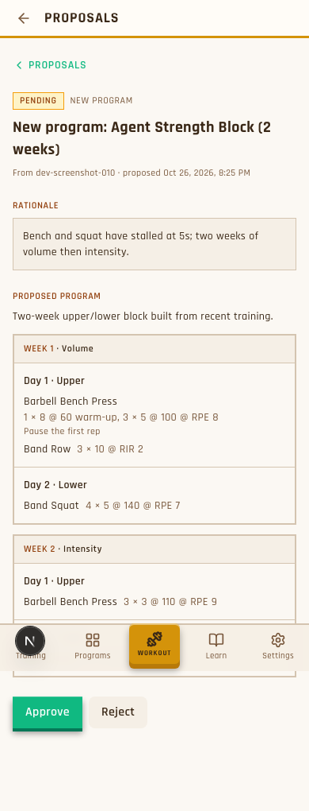
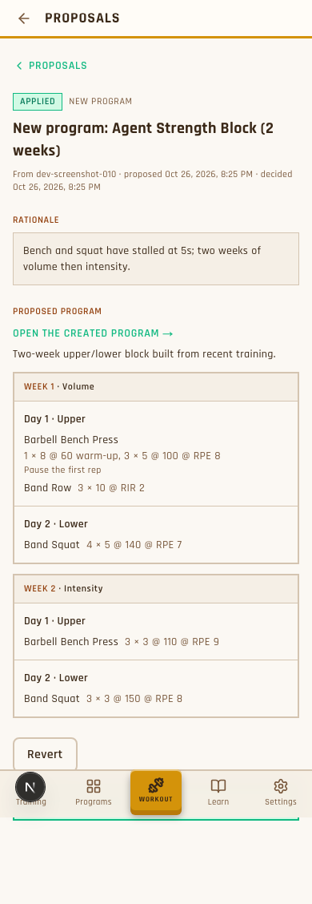

# Slice 2 review: agents propose new programs

**What I need from you:** accept, or say what to change.

## Changed since your phone test (r3)
- **No Revert on program proposals.** This is your call: an approved program is an ordinary program, so you edit or delete it from Programs. Exercise edits keep Revert. If anything calls revert on a program proposal, it's refused with "delete the program from Programs instead".
- **Back button fixed.** On a detail page, the header arrow now goes to its list (for example Proposals), and the extra "< Proposals" link is gone. The same applies across the admin area: an article, message or community program goes back to its list.
- The reviewer re-checked both and found nothing to change. 239/239 tests pass.
 If you accept, I'll commit and open a PR to `dev`; merging is yours. There are two small choices below; the defaults are fine.

## Try it on your phone
**Live preview of this branch:** https://dustins-macbook-pro.tailc29f1d.ts.net:10000/admin/proposals
(It's tailnet only; the link can change if the preview is restarted. Log in with `dmays@test.com` / `password`.)

1. Open **"New program: Phone Test 5x3 (3 weeks)"**, a pending proposal I seeded over MCP, the same way an agent would.
2. Check the outline, then tap **Approve**.
3. Tap **Open the created program**. It should be in Programs, inactive.
4. Try the big one: **"12-Week Upper/Lower Peaking Block"** (12 weeks, 295 exercises, 1,014 sets). Approve it and see how long it takes.
5. Confirm there's no Revert button after approval, and that the header back arrow returns you to the list.

This is the worktree's local dev database. Nothing posts to Discord from the preview.

## What changed
- Agents can **read a whole program**: weeks, days, exercises and prescribed sets (`get_program`).
- Agents can **propose a new program** (`propose_program_create`). Nothing is created until you approve, and you get the usual #proposals Discord post.
- **Approve** creates the program **inactive** and marks it as made by you. Activate it yourself when you want it.
- **No Revert** for programs: once approved, manage it in Programs.
- Bad proposals are refused when proposed: an unknown exercise, an empty day, or RPE outside 1–10. Size limits are 16 weeks, 7 days, 15 exercises and 10 sets.
- The admin proposal page shows an outline of the program instead of a field diff. After approval it links to the program.

## What it looks like (phone width)

Pending, with Approve and Reject:

After approval, with the link (this screenshot predates the change; Revert is now gone):

(The bottom nav overlapping the page is only how the full-page capture renders; it's the same in earlier screenshots.)

## Evidence
- 10 scenarios in `features/agent-tools/program-proposals.feature`. Each has tests that check the database, not just replies.
- The tests were proven against a throwaway version of the code, including 18 deliberately broken versions, each of which was caught.
- **239/239** agent-tools tests pass. The full suite passes (1091) with nothing new failing, and type-check is clean. I re-ran these myself.
- No database migration was needed.

## Independent reviewer's verdict: ready to accept
A separate agent that didn't build or test this reviewed it. Its first pass found one real risk: approving a program at the size limit could take longer than the database's 5-second limit, and you'd get an error page. That's fixed. Approval now gets 30 seconds, and if it still times out, the proposal stays pending with a note saying nothing was applied. Three smaller cleanups were also fixed. Its final verdict: meets the spec, good code, nothing blocking.

## Small choice (default is fine)
1. **A blank program description is saved as empty text** rather than "none". It's harmless. Default: tidy it in a later slice.

## Not verified
- Approval of a maximum-size program (about 1,700 exercises) hasn't been timed. The 30s limit and the clean timeout handling cover it.
- The outline page was checked only from screenshots, not clicked through by the reviewer.

## Dev leftovers
One demo program, "Agent Strength Block" (inactive), and its applied proposal are in the worktree's local database only. Nothing was sent to Discord.

## Process note (V3 trial)
Three agents worked visibly: test-builder, implementer and reviewer. You coached once: agents weren't reliably checking in. Briefs now tell them to message the lead, and the lead subscribes to their idle notices. Your phone-preview idea surfaced a product decision (no program revert) that the tests and the review didn't.
