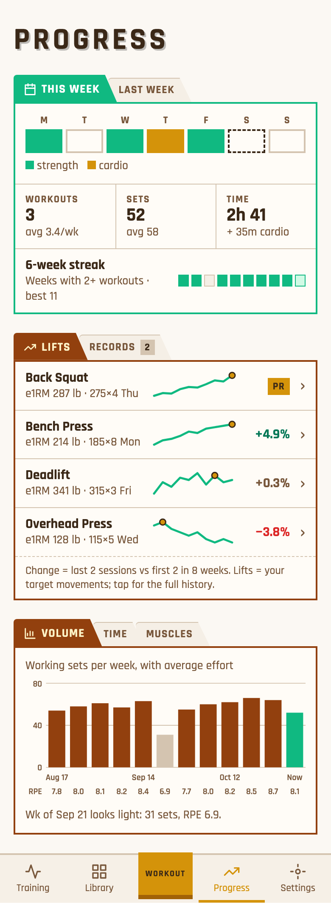
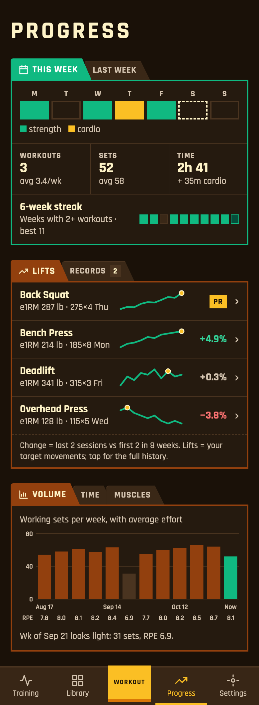
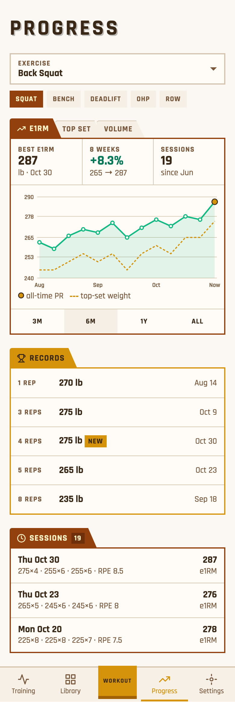
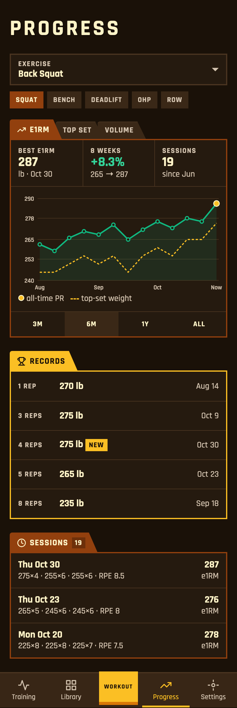
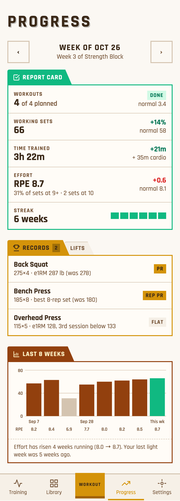
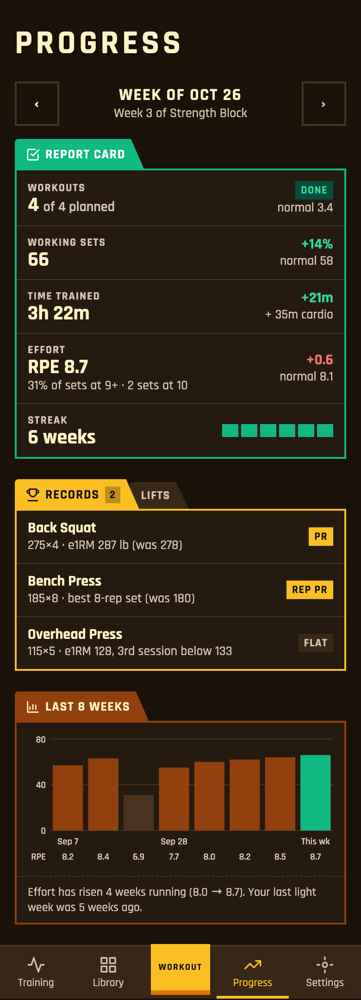

# Analytics tab: pick a page shape

**Decide:** which page shape, what counts as a streak, and what happens to Learn's content. Three questions are waiting in the terminal.

**Finding:** everything can be computed from data we already log. Missing today: week-by-week series, all-time and rep PRs (the logger's "PR" only looks at the last 4 sessions) and streaks. No chart library is needed; small SVG charts in the theme colours work in light and dark. The data in the mockups is made up.

## A: Overview dashboard (recommended as the tab)
This week (days, workouts, sets, time, streak) → Lifts (your anchor lifts with sparklines and PR chips) → Volume (12 weeks of sets with an effort row).

## B: Per-exercise drill-down (recommended behind each lift in A)
Exercise picker → e1RM chart with top sets, range 3M/6M/1Y/All → rep records → sessions.

## C: Weekly report card
This week vs your 8-week normal → records this week → 8-week bars with a deload note. Its comparisons could become a "Last week" tab inside A.

## Proposed slices
- **S1:** weekly series and consistency (A's This week and Volume), plus Learn unlinked from the nav.
- **S2:** lifts and PRs (A's Lifts) plus page B.
- **Later:** deload notes, muscles, cardio, MCP tools. Deleting Learn's tables is a separate migration.

## Not verified
How many of your sets have RPE/RIR or durations (shared data wasn't queried). No timezone is stored, so weeks need a rule.
