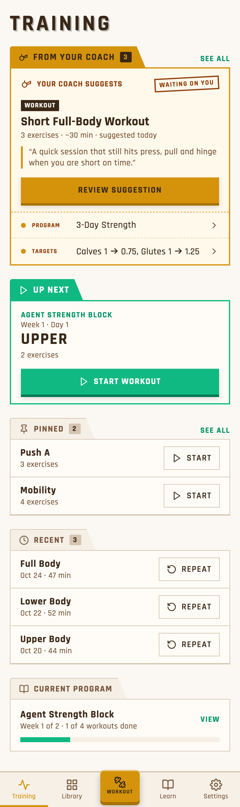
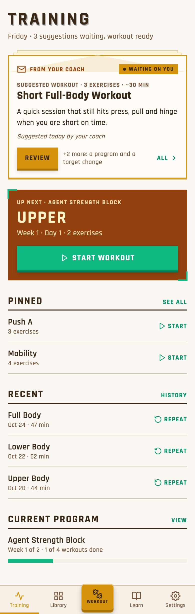
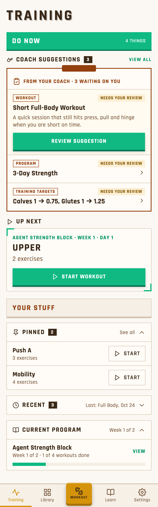
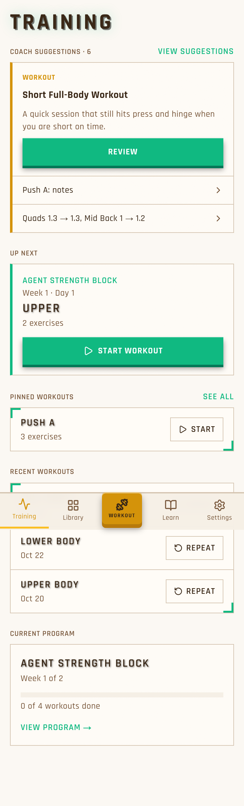

# Training page: pick a direction

Three rough mockups of the Training page. All have the same sections in the same order, the app's colours and fonts, and the same data. Pick one, or mix parts ("A, with B's flat lists").

**Recommended: A**, optionally with B's flat lists for the lower sections.

## A · Folder tabs

Every section gets a folder-style tab. Only the coach tab (gold) and Up Next (green) are filled in; the rest have quiet tan tabs. The suggestion card says "Your coach suggests" and "Waiting on you", has a type chip and quotes the coach's reason. The other 2 suggestions show as rows.

*Trade-off:* the lower half is still a stack of boxes.

## B · Hero + quiet lists

Suggestions arrive as an envelope "From your coach". Up Next becomes a dark hero card with a big Start button. Pinned, Recent and Current Program lose their boxes and become plain lists under large headings.

*Trade-off:* it drifts from the tab idea, and the 2nd and 3rd suggestions are hidden behind "+2 more".

## C · Do now / Your stuff

Two banded zones. "Do now" holds a coach clipboard listing all 3 suggestions, each tagged "Needs your review", followed by Up Next. "Your stuff" holds collapsible Pinned, Recent and Program sections.

*Trade-off:* the busiest of the three, and collapsing needs remembered per-user state.

## Today, for comparison

**Next:** reply with a letter, or a mix. TL5a's PR waits until the chosen direction is built as a follow-up.
