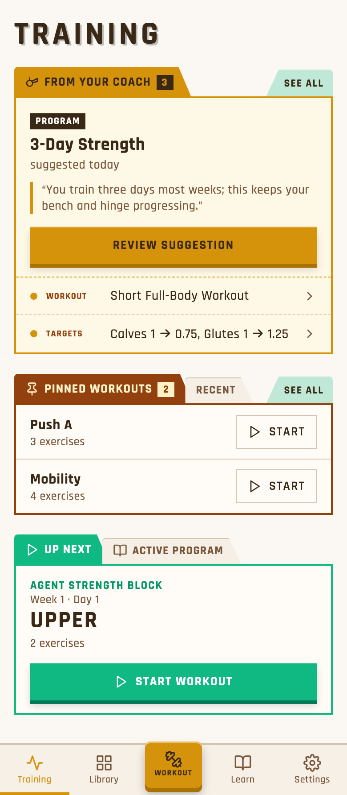
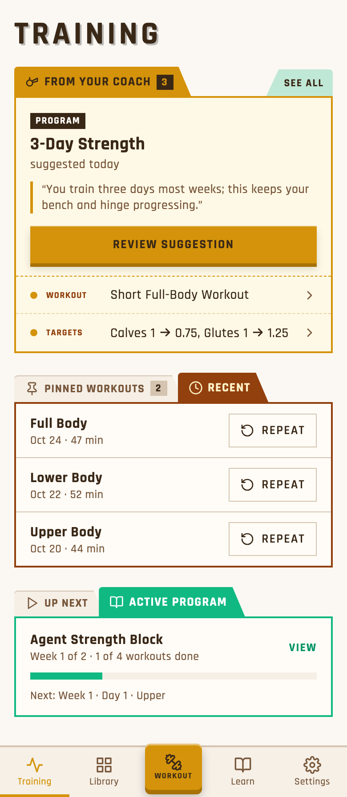
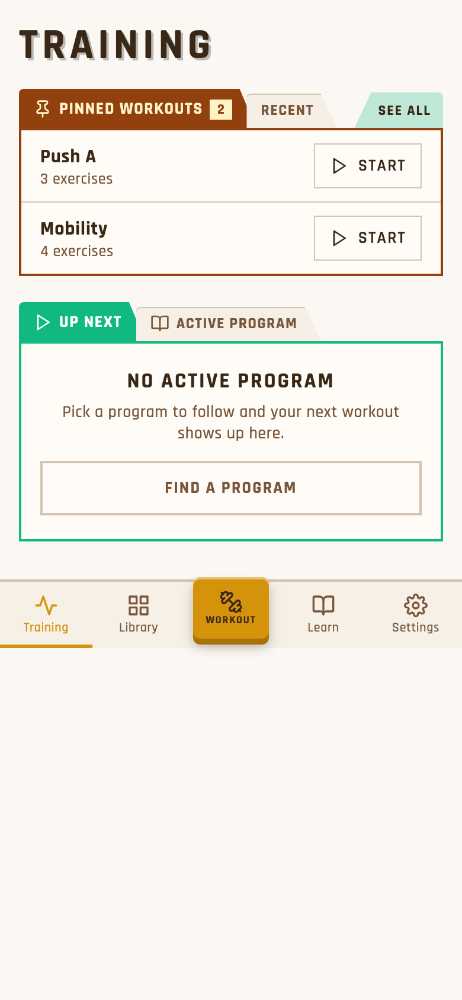
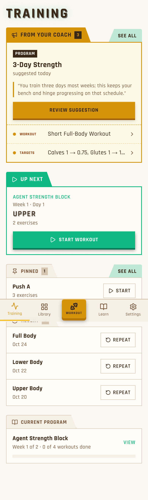

# Training as three tabbed blocks

The consolidated layout you described, built on the folder tabs. There are three blocks, in order:
1. **From your coach**
2. **Workouts:** Pinned Workouts | Recent
3. **Program:** Up Next | Active Program

Tapping a tab switches what its block shows.

**Your call:** confirm it (or tell me what to change), and answer the 4 questions at the bottom.

## 1 · Normal (Pinned Workouts and Up Next selected)

## 2 · Switched (Recent and Active Program selected)

Active Program is today's Current Program row, plus a "Next: Week 1 · Day 1 · Upper" line, and View opens the program.

## 3 · No suggestions, no active program

The coach block hides. The Program block shows a "No active program" placeholder with Find a program.

## Today, for comparison

## Questions (recommended answer first)

1. **Remember which tab you last picked?** Per device (recommended), per account, or not at all. Either way, it never opens an empty tab: with no pins it falls back to Recent.
2. **Does Active Program keep a Start button?** No (recommended): Start lives on Up Next.
3. **Tab label:** "Pinned Workouts" (as you said), or a shorter "Pinned"? The header row is tight at phone width.
4. **The coach tab** stays "From your coach". Users never see the word "proposal" (it's admin wording); the user-facing word is "suggestions".
