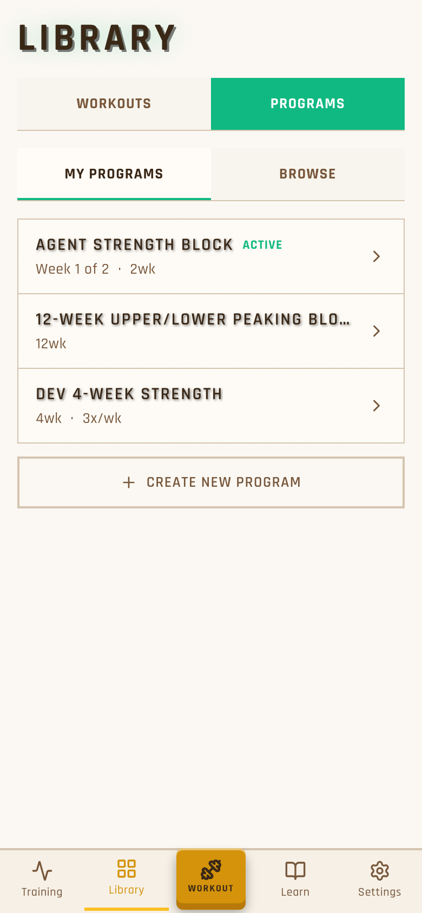
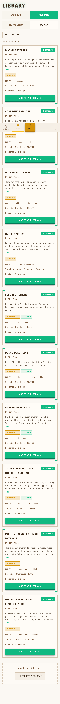
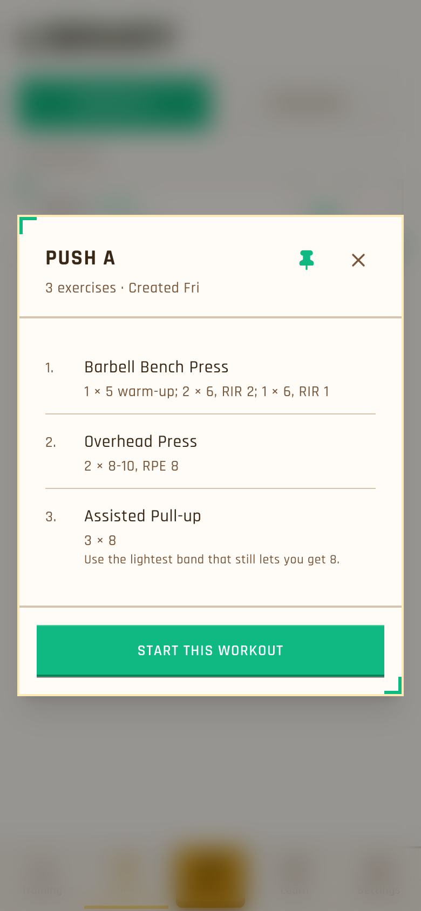
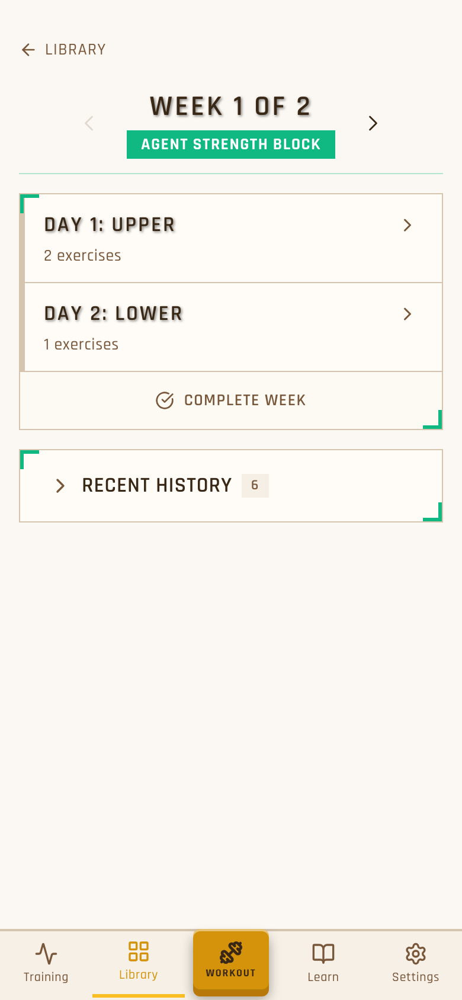
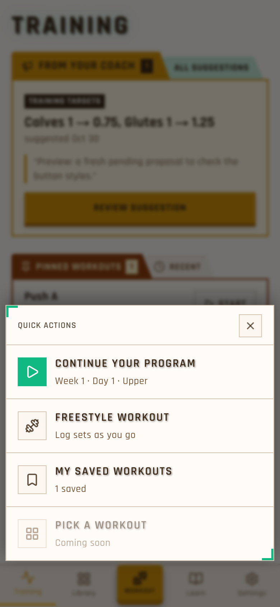
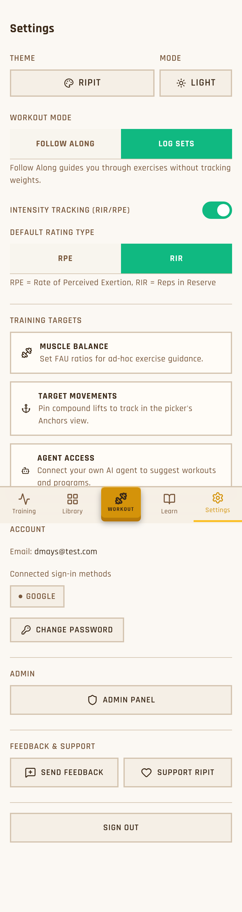
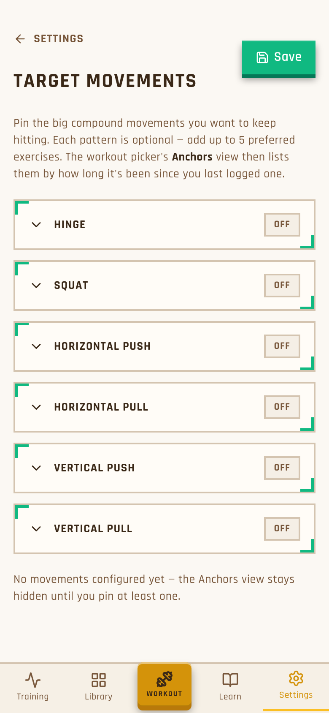
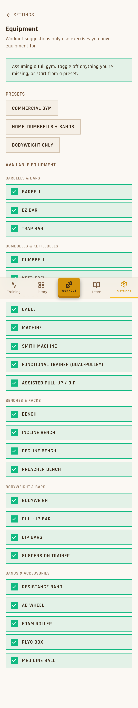

# UI audit: Library, Workout sheet and Settings vs the Training style

Read-only audit for work item 059, 2026-11-01. Branch `feature/ui-audit`. No app code was changed.

**How it was captured:**
- Playwright at 390×844 @2x, because the Chrome extension wasn't connected.
- The build is the one `phone-preview.sh start` made. Because that preview only accepts logins from its tailnet address, it was served on `localhost:3201` with localhost auth.
- User `dmays@test.com`. Existing data was enough, so nothing was seeded.
- Themes: ripit light, ripit dark (the `-dark` files), and doom for two theme spot checks.

Screenshots are in [`screens/`](screens/). Full-page captures show the fixed bottom nav part-way down the page; that's a capture artifact, not a bug.

Learning is out of scope and was not looked at.

## The target: what "Training style" means

Taken from `components/training/SectionTab.tsx`, `TabbedBlock.tsx`, `TrainingHome.tsx` and mockup `training-library/docs/mockups/054/`. See [01-training.png](screens/01-training.png).

**Page title**
- `text-4xl doom-title uppercase` (TRAINING).

**Blocks**
- Each block is a **folder**: a paper tab sits on a box whose border matches the tab.
  - The tab is clip-path slanted on the right with a rounded top-left corner, and holds an icon, a label and a count chip.
  - The box is `border-2` in the tab's colour (`SECTION_BOX`), or `border border-border bg-card` for quiet blocks.
- **Switching** inside a block uses paper tabs in a tablist (`TabbedBlock`):
  - the selected tab is filled and sits in front;
  - unselected tabs are tan (`bg-muted`) and a little lower;
  - keyboard focus is drawn inside the tab (`PAPER_TAB_FOCUS`).
- A link that sits beside the tabs is a **dimmed second tab** (`bg-primary/25`), not a text link.

**Colours**
- Brown (`secondary`) for your own content.
- Green (`primary`) for the program and the next action.
- Gold (`accent`) for the coach.

**Rows inside a box**
- Plain rows: `divide-y`, bold name, muted meta line, outline action button on the right.
- No corner brackets and no text shadow on row titles.

**No `doom-corners`**
- The green L-shaped corner brackets (`app/globals.css:1936`) don't appear anywhere on Training.
- This is the "angled bracket" look Dustin wants gone. It is used in 44 files.

---

## Shared fixes (do these first; each fixes several pages)

| # | What | Where | Fix | Size | Pri |
|---|---|---|---|---|---|
| S1 | Corner brackets (`doom-corners`) on cards, sheets, dialogs and menus | `app/globals.css:1936`. In-scope uses: `CommunityProgramCard.tsx:85`, `CommunityProgramsView.tsx:187`, `SavedWorkoutRow.tsx:36,77`, `SavedWorkoutsList.tsx:125`, `SavedWorkoutDetailDialog.tsx:94`, `QuickActionSheet.tsx:290`, `StrengthWeekView.tsx:544`, `WorkoutHistoryList.tsx:319`, `TargetMovementsEditor.tsx:197`, `MuscleBalanceSettingsEditor.tsx:180,218` | Drop `doom-corners` from these surfaces. Use a quiet folder box (`SECTION_BOX.quiet`) or a toned one (`border-2 border-primary`). Leave the class in globals for out-of-scope screens for now. | M | P1 |
| S2 | Page-level switches are a `SegmentedControl` (filled green half / tan half), not paper tabs | `components/ui/SegmentedControl.tsx`; used at `LibraryView.tsx:289,312` and `settings/page.tsx:175,251` | Pull the tab strip out of `TabbedBlock` into a `PaperTabs` component that can be controlled (value/onChange, so Library can keep `?type=`/`?tab=` in the URL). Use it for Library's two levels. Keep `SegmentedControl` for small in-form options like Workout mode and RPE/RIR, where a switch is the right control. | M | P1 |
| S3 | Page titles differ: TRAINING and LIBRARY are `text-4xl doom-title`, Settings is a small mixed-case `text-xl` | `settings/page.tsx:86`; `ProgramHeader.tsx:45` uses `text-2xl sm:text-4xl doom-title` | Add a `PageTitle` component (`text-4xl font-bold doom-title uppercase tracking-wider`) and use it on Training, Library and Settings. | S | P1 |
| S4 | Settings sub-page headers differ from each other | Muscle balance (`MuscleBalanceSettingsEditor.tsx:149`), Target movements (`TargetMovementsEditor.tsx:150`) and Agent access (`AgentAccess.tsx:166`) are `text-2xl uppercase`; Equipment is `text-xl` mixed case (`EquipmentChecklistEditor.tsx:106`); back-link weights differ | Add a `SubpageHeader`: "← Settings" back link, `text-2xl` uppercase title, one-line intro, and an optional action slot for Save. | S | P2 |
| S5 | List-row titles use `doom-heading` (glow/text shadow), which looks heavier than Training's rows | `MyProgramsList.tsx:167`, `QuickActionSheet.tsx:320,494`, `ProgramCard.tsx:65`, program-detail day titles | In rows, use plain `font-bold uppercase tracking-wider`. Keep `doom-heading` for the one hero title per screen, as Training does on Up Next. | S | P3 |
| S6 | `docs/STYLING.md` describes the old zinc/orange DOOM tables, not the tokens or the folder style | `docs/STYLING.md` | Add a short "Folder blocks" section pointing at `SectionTab` / `TabbedBlock` / `PAPER_TAB_FOCUS` and these rules, so the next screen starts from it. | S | P3 |

---

## Library

  

Dark mode: `02-library-workouts-dark.png`, `05-library-my-programs-dark.png`, `06-library-browse-dark.png`. Doom theme: `15-library-browse-doom-theme.png`.

**Tabs**

| What | Where | Fix | Size | Pri |
|---|---|---|---|---|
| Workouts / Programs is a bold `SegmentedControl` (solid green half), which clashes with the paper tabs | `LibraryView.tsx:289-298` | Paper tabs (S2): "Workouts" and "Programs" with icons (Bookmark, BookOpen), brown for Workouts and green for Programs, with the content in a folder box under them | M | P1 |
| My Programs / Browse is a second, lighter `SegmentedControl` stacked under the first: two different tab styles in a row | `LibraryView.tsx:312-320` | Make it the folder's own tabs: inside the Programs folder, "My Programs" and "Browse" tabs (green). Or make Browse a dimmed link tab ("Browse programs") beside My Programs, as "All suggestions" is | M | P1 |
| The "MY WORKOUTS" label repeats the selected tab | `LibraryView.tsx:303-305` | Remove it once the tab labels the box; a count chip on the tab ("Workouts 1") does the job | S | P3 |

**Workouts**

| What | Where | Fix | Size | Pri |
|---|---|---|---|---|
| Each saved workout is a separate bordered card with corner brackets, and the pin and ⋮ cells are boxed separately | `SavedWorkoutRow.tsx:36` (card), `:60-67` (cells) | Rows in one quiet folder box (`divide-y`), like Pinned on Training. Pin and ⋮ become borderless icon buttons; keep 48px targets | M | P1 |
| "PINNED" is a green text tag | `SavedWorkoutRow.tsx:47` | Use the Pin icon in brown, or a small brown chip, to match the Pinned Workouts tab colour | S | P3 |
| The empty state is a card with corner brackets | `SavedWorkoutsList.tsx:125` | Use a quiet box with the `EmptyLine` style from `TrainingHome.tsx` | S | P2 |
| The row menu (⋮) popover has corner brackets | `SavedWorkoutRow.tsx:77` ([04-workout-row-menu.png](screens/04-workout-row-menu.png)) | Plain `border-2 border-border bg-card` menu | S | P2 |

**Workout detail dialog**

| What | Where | Fix | Size | Pri |
|---|---|---|---|---|
| The dialog has corner brackets, and its cream border reads oddly against the green brackets | `SavedWorkoutDetailDialog.tsx:94` | Use a brown folder tab ("Workout") on a `border-2 border-secondary` box, or a plain `border-2` box | M | P2 |
| "Start this workout" is the green 3D button, while Training's Start in this context is an outline button | `SavedWorkoutDetailDialog.tsx` (footer) | Keep the primary button, but match Training's Start Workout (Play icon plus label) | S | P3 |

**Browse**

| What | Where | Fix | Size | Pri |
|---|---|---|---|---|
| Program cards use corner brackets plus noise on a `border-2` card. This is the old look Dustin named | `CommunityProgramCard.tsx:85` | Each card becomes a folder: a green paper tab with the program name, the STRENGTH chip on the tab, and a `border-2 border-primary/40` (or quiet) box with the description and meta | M | P1 |
| A card is very tall (about 370px for one program), with Level, Equipment, stats and Published on separate lines and a full-width Add button. Only about 2.5 programs fit per screen | `CommunityProgramCard.tsx:85-215` | Use a compact layout: name and chip; a 2-line description; one meta line ("Beginner · machines · 5 wk · 3×/wk"); then "Add" as an outline button on the right, like Training's Start. Drop or fold in "Published 6 days ago" | M | P1 |
| The Beginner/Intermediate chips are outlined tags in different colours from Training's chips | `CommunityProgramCard.tsx` (level badge) | Use the Training chip style (`px-1.5 text-xs font-bold`, filled) | S | P3 |
| The "Level: All" filter is a bordered dropdown button floating above the list | `CommunityProgramsView.tsx` (filter) | Fold it into the folder header as a small dimmed tab ("Level ▾"), or use chips | S | P2 |
| "Request a program" sits in a dashed box at the end | `CommunityProgramsView.tsx` (footer) | Use a quiet box with an outline button; dashed borders appear nowhere else | S | P3 |
| The empty and filtered-empty state uses corner brackets and noise | `CommunityProgramsView.tsx:187` | Quiet box with `EmptyLine` | S | P2 |

**My Programs** (flat look; Dustin is fine with it)

| What | Where | Fix | Size | Pri |
|---|---|---|---|---|
| The list is already a single quiet box, which is close to Training. The only drift is the row titles' `doom-heading` text shadow | `MyProgramsList.tsx:149,167` | S5 only. Optionally show ACTIVE as a green chip, like Training's count chips | S | P3 |
| The Create new program button has a heavier border than the rows | `MyProgramsList.tsx` (create button) | Match Training's quiet outline button | S | P3 |

**Program detail** (reached from My Programs)

| What | Where | Fix | Size | Pri |
|---|---|---|---|---|
| The week card and Recent History each have corner brackets | `StrengthWeekView.tsx:544`, `WorkoutHistoryList.tsx:319` | Make the week a green folder: a "Week 1 of 2" tab with the arrows, and day rows in the box. Recent History becomes a quiet folder with a count chip on its tab | M | P2 |
| The program name is a green filled label under "WEEK 1 OF 2", which reverses the hierarchy | `ProgramHeader.tsx:45` and the name chip | Put the program name as the title, with "Week 1 of 2" in the tab | S | P2 |
| Day titles use `doom-heading` (text shadow) | `StrengthWeekView.tsx` (day rows) | S5 | S | P3 |

---

## Workout centre button: Quick Actions sheet

Dark mode: `08-quick-actions-sheet-dark.png`.

| What | Where | Fix | Size | Pri |
|---|---|---|---|---|
| **Remove the greyed-out "Pick a workout / Coming soon" row** (Dustin's request) | `QuickActionSheet.tsx:430-435` (and `LayoutGrid` from the imports) | Delete the `ActionRow` | S | P1 |
| The sheet has corner brackets | `QuickActionSheet.tsx:290` | Make the sheet a folder: a gold or green "Quick actions" paper tab on a `border-2` box, with the close button inside the box header. Or at least drop `doom-corners` | S | P1 |
| Row titles have a text shadow and the icon chips are boxed. They don't look like Training's rows | `QuickActionSheet.tsx:494` (`ActionRow`), `:320` | Plain bold uppercase titles (S5). Keep the green chip only on "Continue your program", which mirrors Up Next | S | P3 |
| The "Quick actions" title is small muted text in a bordered header strip | `QuickActionSheet.tsx:295` | Move it onto the paper tab (above), which also removes the extra divider | S | P2 |
| The draft and freestyle heads-up states use the same box and `doom-heading` | `QuickActionSheet.tsx:311-405` | Same box change; the heads-up title becomes the plain bold style | S | P3 |

---

## Settings

Dark mode: `09-settings-dark.png`. Doom theme: `16-settings-doom-theme.png`.

**Main page**

| What | Where | Fix | Size | Pri |
|---|---|---|---|---|
| The title is a small mixed-case "Settings", unlike TRAINING and LIBRARY | `settings/page.tsx:86` | `PageTitle` (S3) | S | P1 |
| Sections are only labels and hairline rules (Theme, Workout mode, Training targets, Account, Admin, Feedback & support), so the page reads as one long form | `settings/page.tsx:90-546` | Group them into folder blocks with quiet tabs: **Look** (Theme, Mode), **Workouts** (Workout mode, Intensity, Rating type), **Training targets** (Muscle balance, Target movements, Equipment, Agent access as rows), **Account** (email, sign-in, password, sign out), **Help** (Feedback, Support), plus **Admin** for admins only. One box per block, with rows inside, as on Training | L | P1 |
| The Training targets links are separate bordered cards with icons at uneven indents (the text starts at different x because icon widths differ) | `settings/page.tsx:283-330` | Make them rows in one box (`divide-y`), with a fixed-width icon column and a chevron on the right, as on Training's other rows | S | P2 |
| Theme and Mode are large tan buttons, while Sign out, Change password and Admin panel are full-width tan buttons. The page has many heavy buttons and no hierarchy | `settings/page.tsx:103,150,367,476,493,503,518` | In the blocks above, make these rows with values on the right ("Theme · Ripit ›", "Mode · Light"). Sign out becomes one quiet outline button at the end | M | P2 |
| The Workout mode and RPE/RIR `SegmentedControl`s are fine as in-form switches | `settings/page.tsx:175,251` | No change (see S2); they sit inside the Workouts block | — | — |
| **Equipment** (`/settings/equipment`) has no row on Settings; the only way in is the goals wizard (`GoalsWizard.tsx:143`) | `settings/page.tsx` (Training targets) | Add an "Equipment" row next to Muscle balance and Target movements | S | P2 |

**Sub-pages**

 

Also: `11-settings-muscle-balance.png`, `14-settings-agent-access.png` (each with `-dark`).

| What | Where | Fix | Size | Pri |
|---|---|---|---|---|
| Headers differ (S4). Save floats as a green 3D button beside the title on Muscle balance and Target movements | `MuscleBalanceSettingsEditor.tsx:149`, `TargetMovementsEditor.tsx:150` | `SubpageHeader` with Save in its action slot as an outline button that turns primary when there are changes, or a sticky footer Save | S | P2 |
| Target movements: each movement is its own card with corner brackets | `TargetMovementsEditor.tsx:197` | Movements as rows in one quiet box; open a row to show its exercises | M | P1 |
| Muscle balance: the Target ratios panel and each muscle row use corner brackets and nested boxes (a box in a box in a box) | `MuscleBalanceSettingsEditor.tsx:180,218` | One folder box ("Target ratios" tab) with plain rows, the number input on the right | M | P1 |
| Equipment: each item is a full-width green-filled tile, so 30+ tiles make a wall of green, and Presets are three stacked tan buttons | `EquipmentChecklistEditor.tsx` | One quiet box per category (quiet tab: "Barbells & bars"), checkbox rows inside. Presets as chips in one row | M | P2 |
| Agent access: sections are bare labelled blocks; no folder box | `AgentAccess.tsx:166-270` | Folder boxes: "MCP address", "Your tokens" (with a count chip on the tab), and the create form in the tokens box | S | P3 |

---

## Bugs seen (not style)

1. **`/settings` returns HTTP 500 on the server render, every load, in the production build.**
   - The error is `TypeError: Cannot read properties of null (reading 'useRef')` at `app/(app)/settings/page.tsx:20` (`useSession()` from `lib/auth-client.ts`).
   - The page recovers on the client, so users see it, but each visit logs a 500. Also seen in `next dev` during the 058 review.
   - `/settings` is the only page that calls `useSession()`. Likely cause: better-auth's React hook runs during SSR. The fix is to read the session on the server and pass it in (as the sub-pages do with `getCurrentUser()`), or to gate the hook to the client.
2. **`/sw.js` is redirected (307) when signed out**, so the service worker can't register on `/login`. The console shows "The script resource is behind a redirect".
   - The middleware matcher (`middleware.ts:10`) only skips images and `_next`, so `sw.js` and `swe-worker-*.js` go through the auth redirect.
   - Fix: add `sw\\.js|swe-worker-.*\\.js` (and the manifest, if one exists) to the matcher's exclusions.
3. **Possible:** Settings → Account lists "Connected sign-in methods: GOOGLE" for `dmays@test.com`, who signs in with email and password. This may be seed data; check that the list reads the account providers correctly.

---

## Proposed build items, in order

1. **Shared folder primitives** (M).
   - Extract a controllable `PaperTabs` from `TabbedBlock`. Add `PageTitle` and `SubpageHeader`.
   - Write the STYLING.md "Folder blocks" note (S2, S3, S4, S6). No page changes beyond Training using the extracted parts.
2. **Quick Actions sheet** (S). Remove "Pick a workout", make the sheet a folder, plain rows. This is small, high-visibility, and has no dependencies beyond item 1.
3. **Library tabs and Workouts** (M).
   - Paper tabs for Workouts/Programs and My Programs/Browse, URL-controlled.
   - Saved workouts as rows in one box; the detail dialog and menu without brackets.
4. **Browse and program detail** (M).
   - Compact folder cards for community programs, the filter and footer.
   - Program detail as a week folder, history folder and title fix. My Programs gets S5 only.
5. **Settings main page** (L).
   - Folder blocks; rows instead of heavy buttons; PageTitle; Equipment row.
   - Fix bug 1 (the SSR 500) in the same item, since it's the same file.
6. **Settings sub-pages** (M). SubpageHeader, and the box changes on Muscle balance, Target movements, Equipment and Agent access.

Bug 2 (`sw.js` matcher) is a one-line fix that can go anywhere, or on its own.
