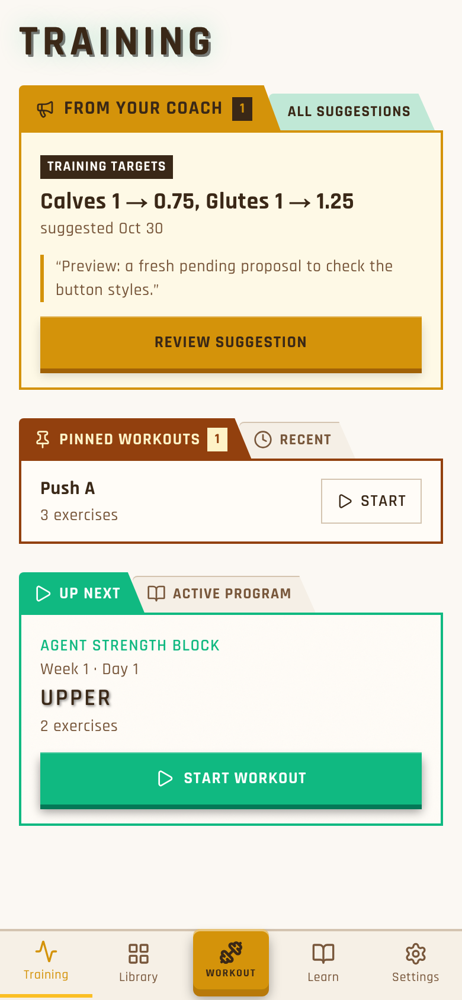
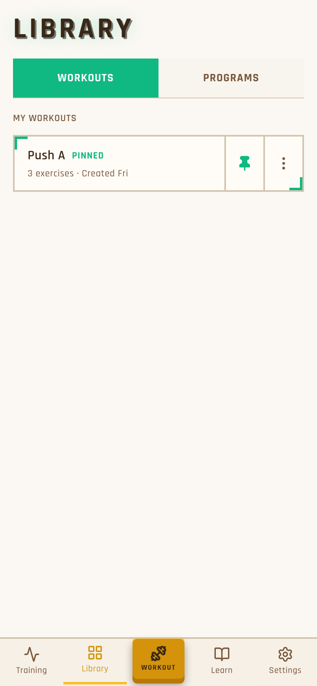

# UI audit + iOS blur: pick what to build

**What I need from you:**
1. Which build items to do, and in what order. My recommendation is all 6, in the order below.
2. Whether to try the iOS blur fix. I recommend yes, as a small item that goes with the first PR.

Nothing has been built yet. Both agents only looked and wrote notes.

## The one big pattern
Training never uses the green **corner brackets** (the "angled bracket" look). Library, Workouts, Quick Actions, program detail and the Settings editors all do. If we drop the brackets on those screens and use Training's folder boxes and paper tabs, most of the old feel goes away.

## Proposed build items (in order)
1. **Shared pieces (M):**
   - paper tabs pulled out of Training so other pages can reuse them;
   - one page-title style (TRAINING / LIBRARY / SETTINGS);
   - one sub-page header;
   - a short styling note so new screens start from this.
2. **Quick Actions sheet (S):** remove "Pick a workout / Coming soon"; make it a folder with plain rows and no brackets.
3. **Library tabs + Workouts (M):** replace the two stacked toggle bars with paper tabs; saved workouts become plain rows in one box; the menu and dialog lose their brackets.
4. **Browse + program detail (M):**
   - Browse cards are about 370px tall (2.5 per screen); they become compact folder cards with an outline Add button.
   - Program detail gets folder blocks.
   - My Programs stays as is, apart from a tiny title fix.
5. **Settings main page (L):**
   - folder blocks (Look / Workouts / Training targets / Account / Help / Admin) with rows instead of heavy tan buttons;
   - a big SETTINGS title;
   - an Equipment row (today it's reachable only from the goals wizard);
   - the fix for the Settings server error already on the roadmap, which is in the same file.
6. **Settings sub-pages (M):** matching headers and boxes for Muscle balance, Target movements, Equipment and Agent access.

## Screens today
Training (the target): 

Library, My Programs: 

Library, Browse: 

Library, Workouts: 

Quick Actions sheet: 

Settings: 

Settings, Equipment: 

## Bugs the audit found
- **Settings page errors on the server** on every load (the client recovers, so you don't see it). Already on the roadmap; it fits in item 5.
- **The service worker file redirects when you're signed out,** so the app's offline helper doesn't register on the login page. One-line fix; it can ride along with any item.
- **Not verified:** Settings → Account shows "Google" as the sign-in method for the test user, who signs in with a password. This may just be seed data.

## iOS blur at the top (research)
- **Likely cause (medium confidence):** Ripit asks iOS for a see-through status bar, so pages scroll underneath it, and the new iOS draws a frosted blur there. Ripit adds no blur of its own.
- **Why Collie is fine:** Collie dropped that setting recently, with a comment about exactly this blur. A WebKit engineer calls the setting deprecated.
- **Fix:** use the standard solid status bar and set a matching top colour (about 2 lines).
- **Trade-off:** a solid band at the top, in one colour that won't match all 12 themes. Making the colour follow the theme could come later.
- **To see it:** delete the home-screen app and add it again, because iOS reads this only when the app is added. Not tested on a device yet.

## Full detail
- Audit (every finding with file, fix, size and priority): `initiatives/ui-audit/docs/audit/README.md`, with 29 screenshots in `audit/screens/`, light and dark.
- Blur note: `initiatives/ui-audit/docs/2026-11-01-ios-pwa-top-blur.md`.
