# Workout screen: pick a direction

**What I need from you:** pick one direction each for the bottom bar, the tab bar and the plan drawer. The agent recommends **A for all three**. Then I'll split the work into build items.

Nothing is built yet. These are rough mockups in the app's real colours and fonts.

## The short version
- **The aged look** comes from about 35 hand-coded bevels and shadows on the header, bottom bar and plan drawer. They also ignore the theme colours.
- **Bug:** the bottom bar disappears after the last planned set, taking prev/next with it.
- **The plan drawer** shows exercise names only, often cut off, with no sign of set progress.
- **Six confirm pop-ups** (complete, exit, delete set and others) aren't real dialogs: Escape doesn't close them and screen readers don't treat them as dialogs. All use the old corner brackets.
- **The tab bar** is the last old underline-style strip in the app. Its "has notes/history" marks are unlabelled 8px squares.

## Today
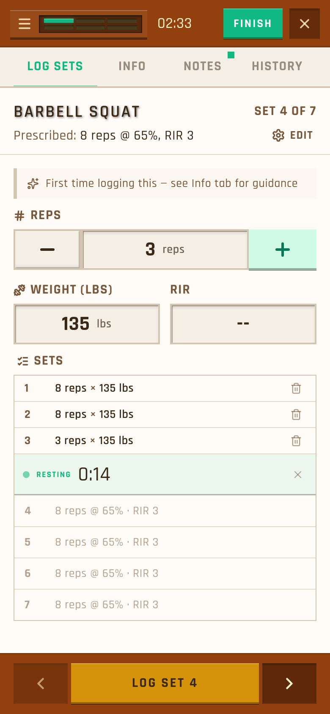

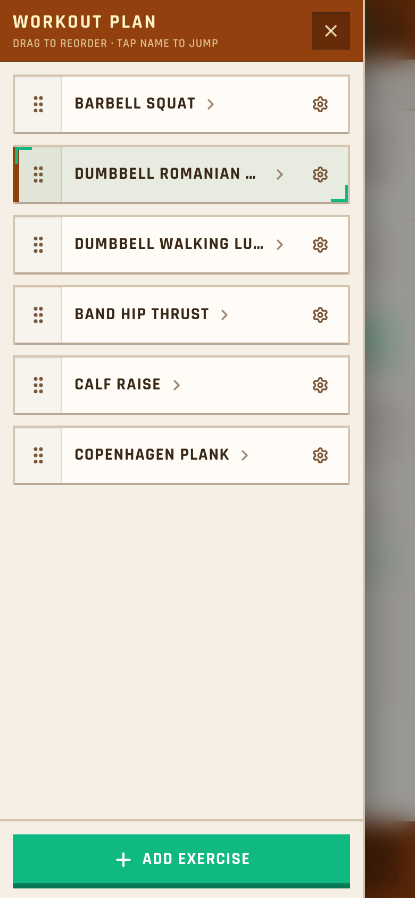

## Bottom bar
**A, flat folder bar (recommended):** outline prev/next squares and a gold LOG SET showing "8 reps × 135 lbs". After the last set it becomes [‹] [+ Extra set] [Next exercise ›] and stays.
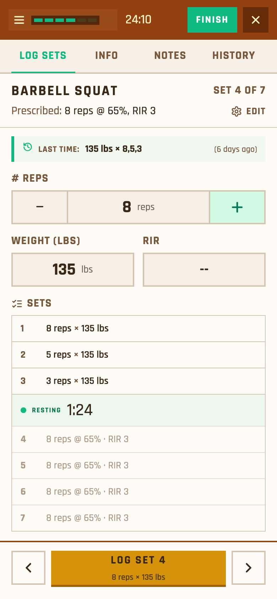
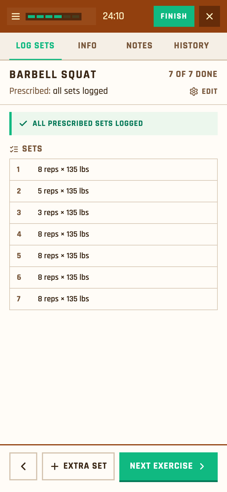

**B, progress strip:** set squares plus "Next: …" above the buttons.
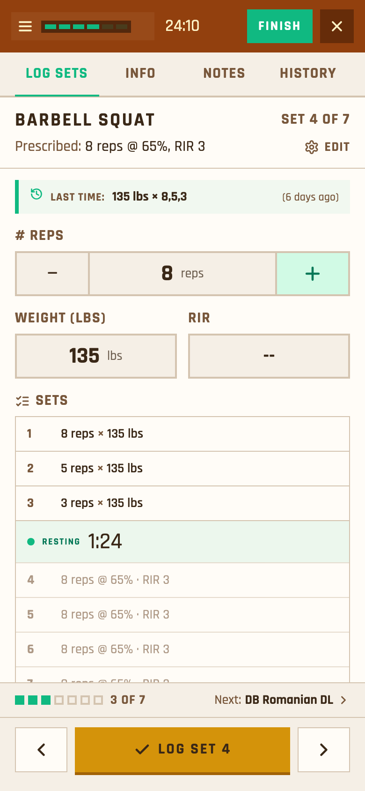

**C, flattened band:** keeps today's layout with the bevels removed. Least change, least gain.
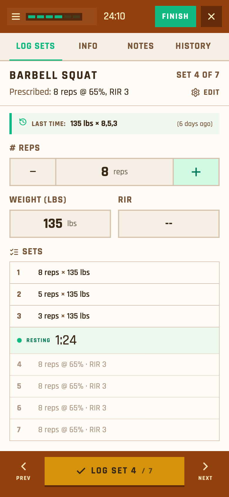

## Tab bar
**A, paper tabs over a folder box (recommended):** LOG · INFO · NOTES 1 · HISTORY 3, the same tabs as Training and Library.
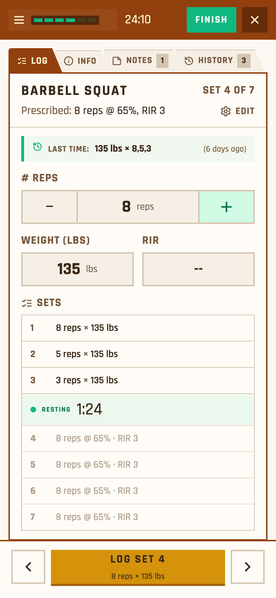

**B, filled chips** under the exercise name.
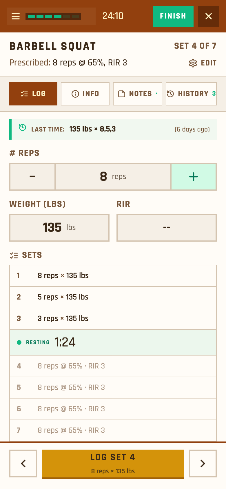

**C, name first,** with slim underline tabs.
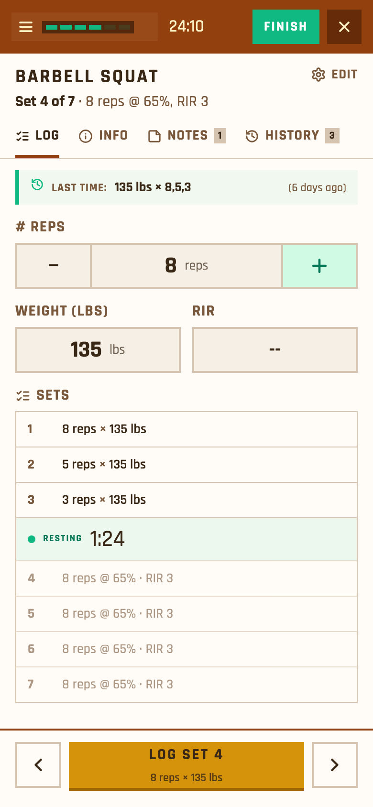

## Plan drawer
**A, folder bottom sheet (recommended):** built like Quick actions, with a "WORKOUT PLAN 2/6" tab and a summary ("9 of 23 sets · 24:10"). Rows show a status square, the full name, set squares and a NOW chip. Reorder and + Add exercise sit at the bottom.
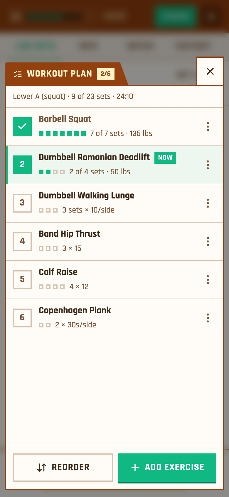

**B, left drawer** with Up next / Done sections. Suits long workouts.
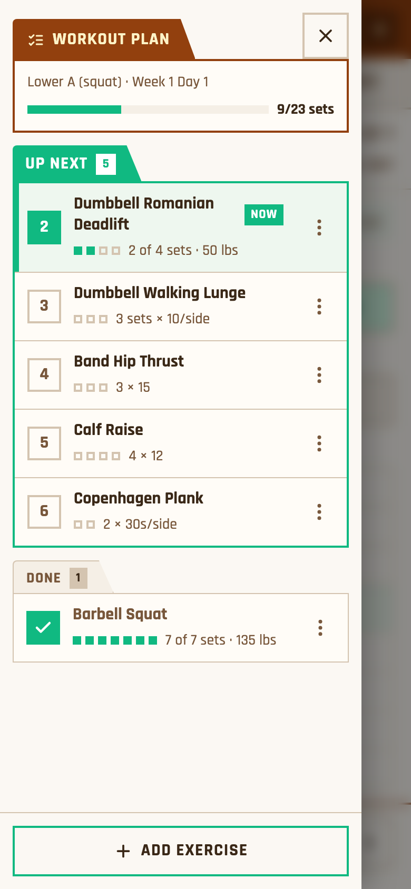

**C, timeline** with swap/remove on the current step. Most novel, least like the rest of the app.
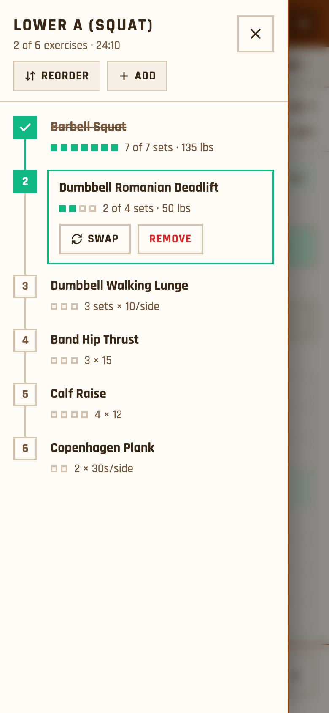

## Proposed build items
1. **Shared pieces (M):** a real confirm dialog for all six pop-ups, the menu style, and swapping the bevels for theme colours.
2. **Bottom bar (M):** one bar for program, follow-along and freestyle workouts, which also fixes the disappearing bar.
3. **Tabs + plan sheet (M–L).**
4. **Later (L):** one exercise picker, and showing a saved workout's planned sets in the freestyle logger. Today they're never shown, a known roadmap gap.

**To check by hand:** LOG SET stayed disabled on Copenhagen Plank ("30s/side" reps) after a weight was entered. This may be the agent's script, not a bug.

Full detail: `initiatives/ui-audit/docs/logger-audit/README.md`, 76 screenshots (light and dark) and the idea HTML files.
